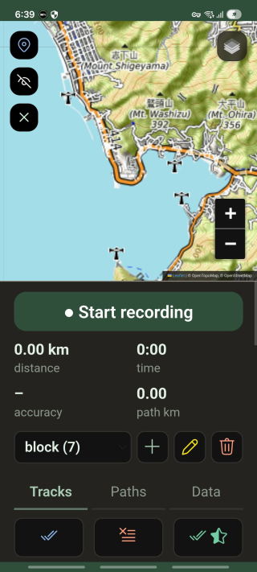

# Trailweaver

Mobile-first, offline-capable web app that records GPS tracks on your device and highlights the paths that emerge where several different walks overlap.

Data stays in your browser, with optional sync to your own PHP and MySQL/MariaDB server.

	

## Features

- Topographic and street maps (Leaflet, OpenTopoMap, OpenStreetMap), dark interface
- GPS recording with screen wake lock and crash recovery
- Track list shows distance, points, and duration, e.g. `0.65 km · 190 pts · 1h 25m`
- Favorites: mark the tracks that lead to a path, and check all, none, or only favorites at once
- Path detection from overlapping walks, colored yellow to red by pass count
- Adjustable merge distance, minimum passes, and GPS accuracy filter, with reset to defaults
- Areas: separate groups of tracks, with a prompt when you start far away; rename or move tracks
- GPX import/export and GeoJSON path export
- Map buttons: center on me, black out the screen to save battery, hide controls
- Installable, works offline, map tiles cached as you browse
- Optional token-protected sync across devices (last write wins), including favorites

### Buttons

Icons are [Codicons](https://github.com/microsoft/vscode-codicons), shown here in the colors the app uses.

| Icon                                                                                                                                                                                                                                                                                                                                                                                                  | Where      | What it does                                                      |
| ----------------------------------------------------------------------------------------------------------------------------------------------------------------------------------------------------------------------------------------------------------------------------------------------------------------------------------------------------------------------------------------------------- | ---------- | ----------------------------------------------------------------- |
|                                                                                                                                                                                                                                                                                                 | Map        | Center the map on me                                              |
|                                                                                                                                                                                                                                                                                             | Map        | Black out the screen to save battery (recording continues)        |
|                                                                                                                                                                                                         | Map        | Hide or show the controls                                         |
|                                                                                                             | Area bar   | New, rename, or delete the area                                   |
|                                                                                                                                                                                                                                                                                               | Tracks tab | Check all tracks                                                  |
|                                                                                                                                                                                                                                                                                               | Tracks tab | Uncheck all tracks                                                |
|                                                                                                                                                                                       | Tracks tab | Check favorite tracks only                                        |
|     | Each track | Find it on the map, move it to another area, rename it, delete it |
|                                                                                                                                                                                     | Each track | Toggle favorite                                                   |

Only checked tracks are drawn and used for path detection.

## Without installation

Open the GitHub Pages address ([https://larasqp.github.io/Trailweaver](https://larasqp.github.io/Trailweaver))  in, e.g., Brave/Chrome on Android and choose Add to Home screen.

> [!CAUTION]
> In this mode, data is kept in the browser's local storage only.
> 
> Clearing site data deletes your tracks, so export GPX regularly if this is important to you.

## With installation (self-hosting)

For multi-device sync, install your own server:

1. Upload the contents of `frontend/` to a web folder served over HTTPS.
2. For sync, upload `backend/api.php` and `backend/config.php` to a PHP 7.4+ server with `pdo_mysql` (same folder as the front end, or enter the full API address in the app).
3. Create a MySQL or MariaDB database (MariaDB 11.4 tested) and a user with all privileges on it.
4. Copy `backend/config.example.php` to `config.php` and set `TW_TOKEN` (random, 16+ characters) and the `DB_*` values. Never commit it.
5. Open the site on your phone and choose Install or Add to Home screen.
6. In the Data tab, enter the same token and tap Save & sync. Tables are created automatically.
7. After each update, bump  `SHELL` in `sw.js` (eg, `v8` to `v9`) so phones fetch the new files. The Data tab shows the active version.

> [!NOTE]
> Tracks are uploaded in batches of 20, so large histories sync without hitting the server's upload limit. If a sync still fails with "Upload too large", raise `post_max_size` in `php.ini`.

## License

**Trailweaver** is released under the [MIT License](LICENSE).